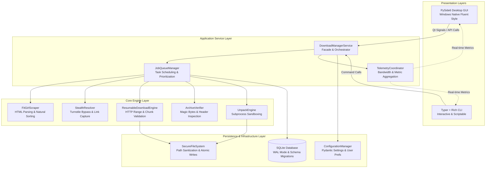
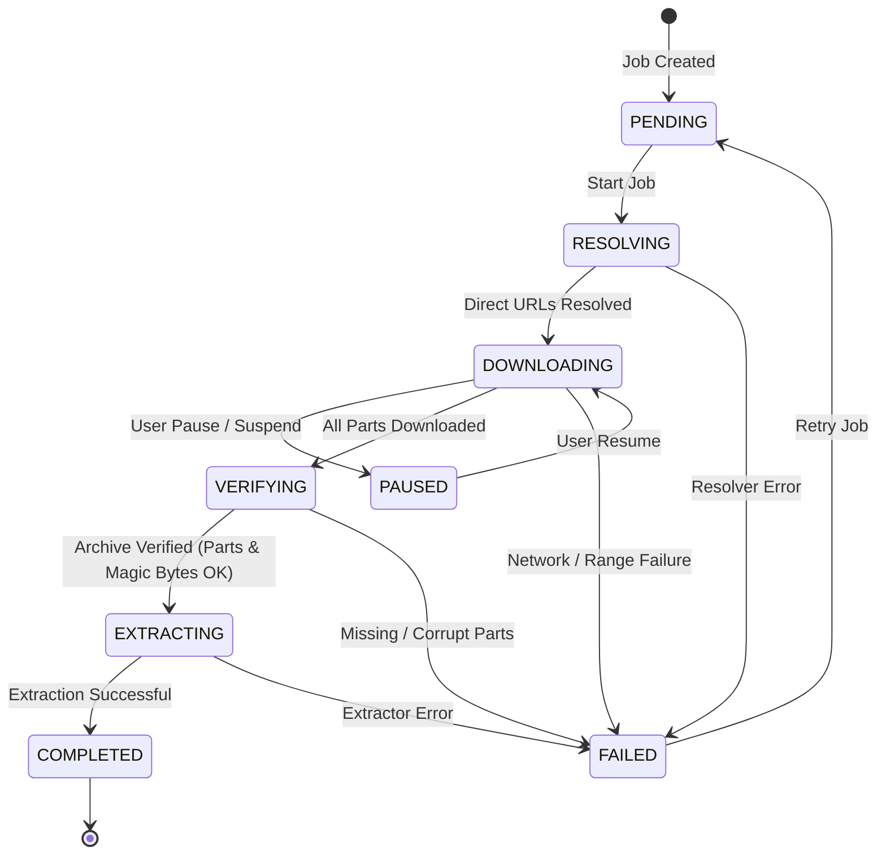
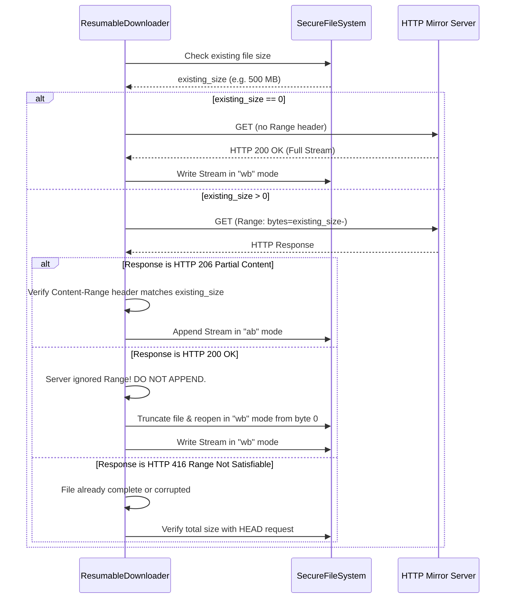

# ARCHITECTURE DESIGN DOCUMENT
**Target System**: FitGirl Repack Downloader (Commercial Windows Application)  
**Document Version**: 2.0.0  
**Status**: Target Architecture Specification  
**Governing Standard**: `Agents.md` Master Project Instructions

---

## 1. Architectural Vision & Principles

The objective is to transform the FitGirl Repack Downloader from a monolithic terminal script into a commercial-grade, dual-interface Windows desktop application.

### Core Architectural Principles:
1. **Single Engine, Dual Interface**: The Core Business Engine must be completely headless and decoupled from UI frameworks. The PySide6 Desktop GUI and the Typer/Rich CLI must be thin presentation layers consuming the same application services.
2. **Persistent State Management**: Download tasks, part progression, and application configurations must be durably stored in an embedded SQLite database using Write-Ahead Logging (WAL) to prevent state loss during system restarts or crashes.
3. **Strict Asynchrony & Thread Isolation**: No network I/O, browser automation, or disk operations may run on the GUI main thread. Communication across boundaries must rely on thread-safe queues, Qt signals/slots, and cooperative cancellation tokens.
4. **Defense-in-Depth Security**: All external input (URLs, scraped HTML, server headers, and archive payloads) must be strictly validated, sanitized, and isolated.

---

## 2. High-Level System Architecture



---

## 3. Package Structure (`src/` Layout)

To eliminate root-directory clutter and prevent import side-effects, the project will be structured under a clean `src/` layout:

```text
fitgirl_downloader/
├── .github/
│   └── workflows/
│       ├── test.yml                 # Cross-platform linting & unit tests
│       └── release.yml              # Windows packaging & installer build
├── src/
│   └── fitgirl_downloader/
│       ├── __init__.py
│       ├── __version__.py
│       ├── config/
│       │   ├── __init__.py
│       │   ├── paths.py             # Dynamic OS path resolution (Registry/PATH)
│       │   └── settings.py          # Pydantic v2 application configuration
│       ├── domain/
│       │   ├── __init__.py
│       │   ├── models.py            # Dataclasses & domain entities (Job, Part)
│       │   ├── state.py             # State machine enums (JobState, PartState)
│       │   └── telemetry.py         # TelemetrySnapshot & metrics
│       ├── storage/
│       │   ├── __init__.py
│       │   ├── database.py          # SQLite connection manager & WAL setup
│       │   ├── migrations.py        # Schema creation & migrations
│       │   └── repositories.py      # JobRepository & PartRepository
│       ├── network/
│       │   ├── __init__.py
│       │   ├── http_client.py       # Requests/HTTP session with retry policy
│       │   ├── range_validator.py   # HTTP 206 / Content-Range validator
│       │   └── stealth_resolver.py  # Playwright background automation
│       ├── engine/
│       │   ├── __init__.py
│       │   ├── scraper.py           # Sanitized FitGirl scraper
│       │   ├── downloader.py        # High-performance chunk downloader
│       │   ├── verifier.py          # Part sequence & magic byte verifier
│       │   └── extractor.py         # Process sandboxed archiver
│       ├── services/
│       │   ├── __init__.py
│       │   ├── manager.py           # DownloadManagerService facade
│       │   └── telemetry.py         # Telemetry aggregation service
│       ├── cli/
│       │   ├── __init__.py
│       │   ├── app.py               # Typer application entry point
│       │   ├── commands/            # download, search, extract, config
│       │   └── ui.py                # Rich dashboard rendering
│       └── gui/
│           ├── __init__.py
│           ├── app.py               # PySide6 application lifecycle
│           ├── main_window.py       # Main application window
│           ├── components/          # TelemetryGrid, ActiveStreamsTable, LogView
│           ├── workers.py           # QRunnable & QThread background workers
│           └── styles.py            # Modern Dark/Light QSS stylesheet
├── tests/
│   ├── unit/                        # Fast isolated unit tests
│   ├── integration/                 # Database, scraper, & network tests
│   ├── gui/                         # PySide6 headless smoke tests
│   └── conftest.py                  # Pytest fixtures & mock servers
├── pyproject.toml                   # Build metadata, dependencies, Ruff, Mypy
├── START.bat                        # Production Windows launcher
└── README.md                        # User documentation
```

---

## 4. Persistent Storage & Database Schema

State persistence will be managed via SQLite 3 using `WAL` (Write-Ahead Logging) and `PRAGMA synchronous = NORMAL` for high concurrency and zero corruption during unexpected process termination.

### Database Schema (DDL):

```sql
CREATE TABLE IF NOT EXISTS jobs (
    id TEXT PRIMARY KEY,
    title TEXT NOT NULL,
    page_url TEXT NOT NULL,
    clean_folder_name TEXT NOT NULL,
    download_dir TEXT NOT NULL,
    extract_dir TEXT NOT NULL,
    total_parts INTEGER NOT NULL DEFAULT 0,
    total_bytes INTEGER NOT NULL DEFAULT 0,
    downloaded_bytes INTEGER NOT NULL DEFAULT 0,
    status TEXT NOT NULL CHECK(status IN ('PENDING', 'RESOLVING', 'DOWNLOADING', 'PAUSED', 'VERIFYING', 'EXTRACTING', 'COMPLETED', 'FAILED')),
    auto_extract INTEGER NOT NULL DEFAULT 1,
    created_at REAL NOT NULL,
    updated_at REAL NOT NULL,
    error_message TEXT
);

CREATE TABLE IF NOT EXISTS download_parts (
    id INTEGER PRIMARY KEY AUTOINCREMENT,
    job_id TEXT NOT NULL REFERENCES jobs(id) ON DELETE CASCADE,
    filename TEXT NOT NULL,
    part_number INTEGER NOT NULL,
    share_url TEXT NOT NULL,
    direct_url TEXT,
    direct_url_expiry REAL,
    total_bytes INTEGER NOT NULL DEFAULT 0,
    downloaded_bytes INTEGER NOT NULL DEFAULT 0,
    status TEXT NOT NULL CHECK(status IN ('PENDING', 'RESOLVED', 'DOWNLOADING', 'COMPLETED', 'FAILED')),
    is_optional INTEGER NOT NULL DEFAULT 0,
    is_selective INTEGER NOT NULL DEFAULT 0,
    retry_count INTEGER NOT NULL DEFAULT 0,
    checksum_sha256 TEXT,
    created_at REAL NOT NULL,
    updated_at REAL NOT NULL,
    UNIQUE(job_id, filename)
);

CREATE TABLE IF NOT EXISTS app_settings (
    key TEXT PRIMARY KEY,
    value TEXT NOT NULL
);
```

---

## 5. Job Lifecycle State Machine



---

## 6. Downloader Engine & Resume Verification Flow

To prevent the critical resume bug identified in the audit, the download engine must enforce strict HTTP Range response verification:



---

## 7. Threading, Concurrency, & UI Decoupling

### Concurrency Model:
1. **PySide6 GUI Thread**: Handles UI rendering, user interaction, animations, and signals. Never executes disk I/O, network requests, or subprocesses.
2. **QThreadPool & QRunnable**:
   - `ResolutionWorker`: Spawns headless browser automation in an isolated thread.
   - `ExtractionWorker`: Manages subprocess execution of 7z/WinRAR with stdout capture.
3. **Download Engine Concurrency**:
   - Managed via Python `ThreadPoolExecutor` or `asyncio` with concurrent worker slots (1 to 5).
   - Telemetry heartbeat runs in a lightweight timer thread (2 Hz to 4 Hz), computing aggregate throughput without acquiring locks during individual chunk writes.
4. **Cancellation Tokens**:
   - Every worker listens to a unified `CancellationToken` (cooperative `threading.Event`).
   - Sockets configure aggressive read timeouts (10s) combined with chunk iteration checks to ensure responsive termination within 500ms of user cancellation.

---

## 8. Presentation Layer Specifications

### 8.1. Typer CLI Architecture
- **Command Structure**:
  - `fitgirl download <url-or-query> [--workers 3] [--dir <path>] [--no-extract] [--all-optionals]`
  - `fitgirl search <query>`
  - `fitgirl jobs [list | pause <id> | resume <id> | cancel <id> | retry <id>]`
  - `fitgirl verify <path>`
  - `fitgirl config [show | set <key> <val>]`
- **Output Mode**: Automatically detects TTY. In interactive terminals, renders full Rich Live telemetry. In CI/scripting pipelines, falls back to structured JSON or plain stream logs.

### 8.2. PySide6 Desktop GUI Architecture
- **Framework**: PySide6 (Qt for Python).
- **Architecture Pattern**: MVVM (Model-View-ViewModel) with Qt Signals and Slots.
- **Visual Design**: Windows 11 Fluent-inspired Dark Theme with accessible contrast ratios.
- **Key Views**:
  - **Dashboard / Active Queue**: Real-time progress bars, speed gauges, active chunk streams, and ETA.
  - **Job History / Manager**: SQLite-backed table of all past downloads, completion statuses, and direct folder open actions.
  - **Repack Search & Link Inspector**: Integrated in-app FitGirl catalog search with selective/optional component toggles before initiating download.
  - **Settings Pane**: Browser selection, concurrent worker limits, custom directories, bandwith throttling, and auto-extraction rules.
