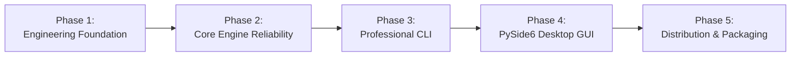

# IMPLEMENTATION ROADMAP & TRANSFORMATION PLAN
**Target System**: FitGirl Repack Downloader (Commercial Windows Application)  
**Date**: November 23, 2026  
**Auditor & Architect**: Lead Python Engineer  
**Status**: Phases 1–4 Completed (Fully Tested & Verified)  
**Governing Standard**: `Agents.md` Section 12 (Working Rules & Milestones)

---

## 1. Roadmap Overview & Phased Milestones

| Phase | Milestone | Status | Key Deliverables |
| :--- | :--- | :--- | :--- |
| **Phase 1** | Engineering Foundation | **COMPLETED** | `pyproject.toml`, Ruff, Mypy, structured logging (`logger.py`), validated settings (`settings.py`), domain exceptions (`exceptions.py`), GitHub Actions CI. |
| **Phase 2** | Core Engine Reliability | **COMPLETED** | HTTP 206 Range resumption fix, atomic `.part` transfers, Path Traversal defense (`security.py`), SQLite WAL job storage (`storage.py`), disk space guard. |
| **Phase 3** | Professional CLI | **COMPLETED** | Unified application service (`services.py`), Rich console telemetry (`terminal_ui.py`), Typer subcommands (`cli.py`), backward-compatible `main.py`. |
| **Phase 4** | PySide6 Desktop GUI | **COMPLETED** | Windows 11 Fluent dark theme (`gui/styles.py`), background Qt worker threads (`gui/workers.py`), 8 application views (`gui/views/`), graceful shutdown, headless `pytest-qt` suite. |
| **Phase 5** | Distribution & Packaging | **PENDING** | PyInstaller standalone Windows executable bundle, desktop shortcut creator, Inno Setup installer. |

---

## 2. Phase Summaries

### Phase 1: Engineering Foundation (COMPLETED)
- Configured Ruff, Mypy, and Pytest in `pyproject.toml`.
- Implemented structured logging with rotating file handlers and safe Windows lock release.
- Added immutable, validated `AppSettings` with directory creation safeguards.
- Standardized domain exceptions hierarchy inheriting from `FitGirlDownloaderError`.
- Consolidated GitHub Actions CI pipeline.

### Phase 2: Core Download Engine Reliability (COMPLETED)
- Remediated BUG-01 (HTTP 206 partial content resume vs 200 truncate).
- Remediated BUG-02 (Path Traversal sanitization and Windows reserved device name protection).
- Implemented SQLite persistent storage with WAL mode and transaction contexts.
- Added disk space pre-flight validation and exponential backoff retry policies.

### Phase 3: Professional CLI (COMPLETED)
- Created application service facade `DownloadManagerService`.
- Decoupled terminal rendering into `terminal_ui.py`.
- Implemented full Typer CLI: `download`, `search`, `jobs`, `history`, `verify`, `extract`, `diagnostics`, `config`.
- Preserved 100% backward compatibility for direct URL calls via `main.py`.

### Phase 4: Windows Desktop GUI using PySide6 (COMPLETED)
- Native PySide6 application with 8 modular views:
  1. `DashboardView`: Key telemetry metric cards, quick-download bar, activity feed.
  2. `ActiveDownloadsView`: Per-worker stream progress, overall completion bar, cancel button.
  3. `QueueView`: FitGirl catalog live search, results table, direct download emitter.
  4. `HistoryView`: SQLite job history table, Windows Explorer folder opener, resume trigger.
  5. `ArchiveVerificationView`: Directory scanner, sequence validation, 7z/WinRAR extractor.
  6. `SettingsView`: Interactive sliders, spinboxes, checkboxes, and file dialog selectors.
  7. `DiagnosticsView`: Live subsystem status badges (Browser, Unpacker, Storage, SQLite).
  8. `AboutView`: Technical specs, thread safety disclosures, legal notice.
- Asynchronous worker threads (`DownloadWorker`, `ResolverWorker`, `ExtractionWorker`) communicating strictly through Qt signals/slots with zero main thread blocking.
- Controlled shutdown sequence in `closeEvent` requesting worker cooperative termination.
- 7 headless GUI smoke tests using `pytest-qt` running in offscreen mode.
