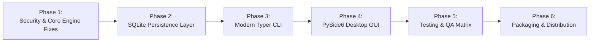

# IMPLEMENTATION ROADMAP & TRANSFORMATION PLAN
**Target System**: FitGirl Repack Downloader (Commercial Windows Application)  
**Date**: November 23, 2026  
**Auditor & Architect**: Lead Python Engineer  
**Status**: Pending User Approval  
**Governing Standard**: `Agents.md` Section 12 (Working Rules & Milestones)

---

## 1. Roadmap Overview & Phased Milestones

To transform this repository into a commercial-quality Windows application without breaking existing functionality, execution is structured into six discrete, verifiable phases:

---

## 2. Phase Breakdown

### Phase 1: Security Hardening & Core Engine Stabilization
**Goal**: Remediate critical data integrity bugs and security vulnerabilities without altering existing external interfaces.

- **Milestone 1.1**: Package Layout Restructuring
  - Transition from flat root files to `src/fitgirl_downloader/` layout.
  - Maintain root compatibility shims (`main.py`, `config.py`, etc.) to prevent breaking external scripts or batch runners.
  - Eliminate import-time side effects (`mkdir` calls in `config.py`).
- **Milestone 1.2**: Security Remediation
  - Implement strict filename sanitization to eliminate Path Traversal (CWE-22).
  - Add path containment assertions before file writes.
  - Add `--` argument delimiter to subprocess invocations in `extractor.py`.
- **Milestone 1.3**: Downloader Engine Bug Fixes
  - Fix HTTP 206 vs 200 resume bug: strictly verify partial content response before appending.
  - Eliminate the arbitrary 2 GB default part estimate; replace with indeterminate size tracking.
  - Fix telemetry `completed_files` double-counting.
- **Verification Gate**:
  - All existing unit tests pass.
  - New regression tests verify path traversal rejection and Range header resume behavior.

---

### Phase 2: SQLite Persistence Layer & Job Management
**Goal**: Enable reliable task recovery, multi-part state tracking, and resume across application restarts.

- **Milestone 2.1**: Database Schema & Migration Engine
  - Create SQLite database manager with WAL mode enabled (`PRAGMA journal_mode=WAL`).
  - Implement schema for `jobs`, `download_parts`, and `app_settings`.
- **Milestone 2.2**: Repository Layer
  - Implement `JobRepository` and `PartRepository` with ACID transaction guarantees.
  - Store resolved direct download links, expiry timestamps, downloaded byte offsets, and part statuses.
- **Milestone 2.3**: Application Service Facade
  - Implement `DownloadManagerService` as the unified orchestration API consumed by both CLI and GUI.
- **Verification Gate**:
  - Integration tests verifying job creation, state transitions, pause/resume persistence, and crash recovery.

---

### Phase 3: Commercial CLI Overhaul (Typer + Rich)
**Goal**: Provide a professional, interactive, and scriptable command-line interface.

- **Milestone 3.1**: Typer Command Suite
  - `download`: Single-line or interactive repack download with live telemetry.
  - `search`: Catalog search with selectable download triggers.
  - `jobs`: List active, paused, and completed jobs with pause/resume/cancel subcommands.
  - `verify`: Standalone archive verification and non-destructive integrity check.
  - `config`: View and update user preferences (download path, worker threads, auto-extract).
- **Milestone 3.2**: Rich Telemetry Refactoring
  - Decouple dashboard rendering from core engine locks.
  - Provide non-TTY mode (clean machine-readable JSON/plain logging) for CI/headless environments.
- **Verification Gate**:
  - CLI command unit tests using Typer `CliRunner`.
  - Manual interactive verification on Windows terminal.

---

### Phase 4: PySide6 Desktop GUI Implementation
**Goal**: Build a modern, native-feeling Windows desktop interface sharing the core engine.

- **Milestone 4.1**: PySide6 Application Skeleton & Theme
  - Set up PySide6 desktop lifecycle, window management, and Windows 11 Fluent dark/light styling.
  - Implement system tray minimization and notification alerts.
- **Milestone 4.2**: MVVM Architecture & Threading
  - Implement Qt Worker threads (`QRunnable` / `QThread`) for resolver and extraction tasks.
  - Wire Qt signals/slots to the `DownloadManagerService` telemetry callbacks.
  - Ensure zero blocking of the Qt main event loop under heavy download loads.
- **Milestone 4.3**: GUI Views & Controls
  - **Queue View**: Live multi-stream download meters, aggregate speed graphs, and pause/resume buttons.
  - **Search & Add View**: Repack catalog browser with optional/selective component checkboxes.
  - **Settings Dialog**: Custom directory selection (via `QFileDialog`), worker limits, and browser path configuration.
- **Verification Gate**:
  - Headless PySide6 smoke tests using `pytest-qt`.
  - Responsive UI verification during 5-stream download stress test.

---

### Phase 5: Testing Expansion & Code Quality Hardening
**Goal**: Enforce commercial-grade code standards across all platforms.

- **Milestone 5.1**: Static Analysis & Linting
  - Add `pyproject.toml` configuring `ruff` (formatting & linting) and `mypy` (strict typing).
  - Resolve all lint warnings and typing gaps.
- **Milestone 5.2**: Comprehensive Automated Test Suite
  - Unit tests for all domain models, repositories, and network validators.
  - Mocked HTTP integration tests for edge cases (HTTP 403, 404, 429 rate limiting, 500 server errors).
  - Target test coverage: >= 85%.
- **Milestone 5.3**: CI/CD Modernization
  - Consolidate GitHub Actions into a single multi-stage workflow testing on `windows-latest` and `ubuntu-latest`.
  - Add automated Ruff and Mypy validation steps.
- **Verification Gate**:
  - All CI workflow checks pass green on both Windows and Linux runners.

---

### Phase 6: Packaging, Distribution & Documentation
**Goal**: Provide standalone Windows binaries and complete technical documentation.

- **Milestone 6.1**: Windows Distribution Packaging
  - Configure PyInstaller spec file for standalone single-file or folder distribution.
  - Optional Inno Setup script to generate a standard Windows setup installer (`.exe`).
- **Milestone 6.2**: Complete Documentation Suite
  - Deliver `INSTALLATION.md`, `TROUBLESHOOTING.md`, `SECURITY.md`, and `CHANGELOG.md` per `Agents.md` Section 10.
  - Update `README.md` with GUI screenshots and modern CLI instructions.
- **Verification Gate**:
  - Clean installation and execution test on a fresh Windows sandbox environment.

---

## 3. Immediate Next Steps & Approval Request

This concludes the audit phase. In accordance with `Agents.md` Section 12 ("THIRD: Wait for approval if the change is architectural, destructive, or affects user data"):

**No existing files have been modified, deleted, or renamed.**

The comprehensive findings are preserved in:
- `PROJECT_AUDIT.md`
- `ARCHITECTURE.md`
- `BUG_REPORT.md`
- `SECURITY_AUDIT.md`
- `IMPLEMENTATION_ROADMAP.md`

**Awaiting user approval to proceed with Phase 1 (Security Hardening & Core Engine Stabilization).**
