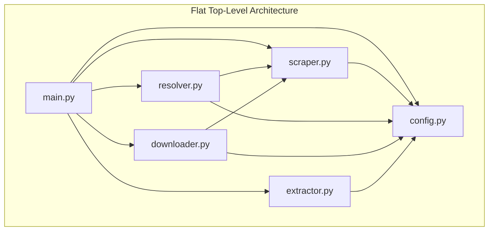

# PROJECT AUDIT REPORT
**Target System**: FitGirl Repack Downloader (Pure CLI / Prototype)  
**Evaluator**: Senior Software Architect & Lead Python Engineer  
**Date**: November 23, 2026  
**Status**: AUDIT-ONLY (No code modified)  
**Governing Standard**: `Agents.md` Master Project Instructions

---

## 1. Executive Summary

This comprehensive audit evaluates the current implementation of the FitGirl Repack Downloader against commercial-grade Windows software requirements and the architectural mandates codified in `Agents.md`.

The current codebase is a functional terminal-based prototype capable of scraping FitGirl repack pages, resolving direct download links from `fuckingfast.co` using a local browser automation mechanism (Playwright), downloading multi-part files with HTTP Range requests, and triggering archive extraction via WinRAR/7-Zip.

However, the application is currently structured as a flat collection of top-level scripts rather than a modular, enterprise-ready Python package. Significant architectural, concurrency, security, and quality assurance deficiencies exist that prevent it from meeting commercial standards:
1. **Security Vulnerability**: A confirmed **Path Traversal vulnerability** in filename parsing exposes the host filesystem to arbitrary file writes.
2. **Data Integrity Flaw**: An HTTP Range resume bug appends full HTTP 200 payload streams onto existing partial files if a server does not serve HTTP 206 Partial Content, causing silent multi-gigabyte archive corruption.
3. **Missing Persistence**: No database or structured transactional state management exists; state is stored in memory and an uncoordinated flat JSON cache file.
4. **GUI Absence**: The GUI was previously deleted, leaving only a terminal interface, violating the dual CLI/GUI requirement of `Agents.md`.
5. **Architectural Gaps**: Eager side-effects on import, hardcoded Windows absolute paths, synchronous blocking browser automation, broad exception swallowing, and an incomplete test suite.

---

## 2. In-Depth Inspection of 12 Core Domains

### 2.1. Every Python Source File

| File | Lines | Primary Purpose | Architectural Evaluation |
| :--- | :--- | :--- | :--- |
| `config.py` | 50 | Constants, path resolution, directory initialization | **Deficient**: Executes `mkdir()` on module import (lines 10-11), causing filesystem pollution during testing. Hardcodes Windows `C:\` drive paths for browsers and archivers without dynamic registry or PATH queries. |
| `scraper.py` | 154 | Web scraping of FitGirl pages and search queries | **Deficient**: Directly trusts URL hash fragments for filenames without sanitization (lines 46, 85). Fragile HTML parsing coupled to specific WordPress theme DOM structure. |
| `resolver.py` | 181 | Turnstile bypass via Playwright browser automation | **Deficient**: Uses synchronous Playwright (`sync_playwright`) that blocks threads. Reads/writes `resolved_cache.json` synchronously without file locks. Swallows fatal exceptions with `pass`. |
| `downloader.py` | 364 | Concurrent multi-file HTTP downloader and telemetry | **Deficient**: Critical resume corruption bug (fails to verify HTTP 206 before appending). Arbitrary 2 GB placeholder size distorts progress. Lock contention on every 1 MB chunk write. |
| `extractor.py` | 122 | Multi-part RAR verification and external extraction | **Deficient**: Scans only `.rar` extensions (missing `.7z.001`, `.bin`). Validates only non-zero size without checking archive magic bytes or test extraction (`unrar t`). Identifies and promotes untrusted `.exe` files. |
| `main.py` | 456 | CLI interface, Rich Live dashboard, interactive menu | **Deficient**: Directly coordinates low-level scraper, resolver, downloader, and extractor without an application service layer or job management repository. Uses standard `argparse` rather than `typer`. |

---

### 2.2. Requirements & Dependency Versions

Current `requirements.txt`:
```text
requests>=2.31.0
beautifulsoup4>=4.12.0
playwright>=1.40.0
curl_cffi>=0.7.0
rich>=13.0.0
tqdm>=4.66.0
```

#### Identified Issues:
1. **Unused Dependencies**: 
   - `tqdm`: Included in `requirements.txt` but never imported or referenced in any Python source file. The application uses `rich.live.Live` exclusively.
   - `curl_cffi`: Included in `requirements.txt` and present in virtual environment, but completely unused. Standard `requests.Session` is used in `downloader.py` and `scraper.py`.
2. **Missing Required Dependencies (per `Agents.md`)**:
   - `PySide6`: Required for the Windows GUI application (Section 3 & Section 7).
   - `typer`: Required for the structured CLI application (Section 3).
   - `pydantic`: Recommended for strict runtime schema validation, configuration loading, and serialization.
   - `ruff`: Required for lightning-fast linting and code formatting (Section 8).
   - `mypy`: Required for static type checking (Section 8).
3. **Version Pinning**:
   - Using `>=` without ceiling constraints or hash pinning increases vulnerability to upstream breaking changes and supply-chain attacks.

---

### 2.3. Startup Batch Script (`START.bat`)

Current `START.bat`:
```batch
@echo off
title FitGirl Repack Downloader (Terminal Edition)
cd /d "%~dp0"
...
if not exist ".venv\Scripts\python.exe" (
    echo Setting up virtual environment .venv...
    python -m venv .venv
    ...
    .venv\Scripts\python.exe -m pip install --quiet -r requirements.txt
)
.venv\Scripts\python.exe main.py %*
```

#### Deficiencies:
1. **Missing Playwright Browser Installation**: Does not execute `playwright install chromium`. If a user does not have Brave, Chrome, or Edge installed at the exact hardcoded default paths, the resolver fails immediately with `RuntimeError: No compatible browser found`.
2. **Vulnerability to Path Spaces**: Unquoted `%*` in `.venv\Scripts\python.exe main.py %*` can cause argument truncation when passing directory paths containing spaces.
3. **No Python Discovery or Version Verification**: Assumes `python` is on PATH and meets the `>= 3.10` requirement. Does not invoke `py -3` (Windows Python Launcher) or check for Python 64-bit architecture.

---

### 2.4. Documentation (`README.md`)

#### Deficiencies:
1. **Outdated Product Scope**: Reflects a pure terminal application and does not mention GUI or planned commercial desktop capabilities.
2. **Missing System Prerequisites**: Fails to clearly specify that a Chromium-based browser (Brave, Chrome, or Edge) and WinRAR or 7-Zip must be pre-installed on the system for resolution and extraction to function.
3. **Missing Technical Documentation**: Lacks the required documentation suite mandated by `Agents.md` Section 10: `ARCHITECTURE.md`, `INSTALLATION.md`, `TROUBLESHOOTING.md`, `SECURITY.md`, and `CHANGELOG.md`.

---

### 2.5. GitHub Actions Workflows

Two workflows exist in `.github/workflows/`:
1. `python-app.yml` (triggers on push/PR to `main`, tests Python 3.10).
2. `python-package.yml` (triggers on push/PR to `main`, tests matrix Python 3.9, 3.10, 3.11).

#### Deficiencies:
1. **Redundant Duplication**: Both workflows run concurrently on every push and pull request, executing nearly identical `flake8` and `pytest` jobs and wasting CI minutes.
2. **Platform Incompatibility**: Both workflows run on `ubuntu-latest`. The current codebase hardcodes Windows paths (`C:\Program Files\...`, `UnRAR.exe`). While existing unit tests pass on Linux because they use temporary mock files, any end-to-end integration tests exercising browser detection or extraction will fail on Ubuntu runners.
3. **Missing Windows CI Validation**: Commercial Windows software must be validated on `windows-latest` runners.
4. **Missing Modern Tooling**: Neither workflow executes `ruff` or `mypy` as required by `Agents.md` Section 8.

---

### 2.6. Module Dependencies & Import Relationships



#### Deficiencies:
1. **Import-Time Side Effects**: `config.py` executes `DOWNLOAD_DIR.mkdir(parents=True, exist_ok=True)` and `EXTRACT_DIR.mkdir(parents=True, exist_ok=True)` at the top level. Importing `config` in tests or external scripts creates physical folders on disk immediately.
2. **Tight Coupling to `main.py`**: Business orchestration logic is mixed directly into the console UI script. Neither CLI nor GUI can be tested or instantiated independently of the console runner.
3. **No Domain Package**: All modules reside in the root directory rather than a structured `src/fitgirl_downloader/` package namespace.

---

### 2.7. Download & Resume Implementation

#### Confirmed Defects:
1. **HTTP 206 vs 200 Partial Content Failure (Critical)**:
   In `downloader.py` lines 209-235:
   ```python
   if existing_size > 0 and supports_range:
       headers["Range"] = f"bytes={existing_size}-"
       mode = "ab"
   ...
   with self.session.get(item.direct_url, headers=headers, stream=True, timeout=TIMEOUT) as resp:
       if resp.status_code not in (200, 206):
           raise RuntimeError(f"HTTP Status {resp.status_code}")
       with open(file_path, mode) as f:
           for chunk in resp.iter_content(chunk_size=CHUNK_SIZE):
               f.write(chunk)
   ```
   If a mirror CDN, caching proxy, or expired token causes the server to ignore the `Range` header and respond with `HTTP 200 OK`, the response payload contains the **entire file from byte 0**. Because `mode` is `"ab"`, the entire file is appended to the existing partial file. A 2 GB part becomes 3.5 GB, irreparably corrupting the archive.
2. **Arbitrary 2 GB Placeholder Size**:
   In `downloader.py` lines 316-318:
   `self._file_total_map[item.filename] = 2 * 1024 * 1024 * 1024`
   When items have not had their remote sizes queried prior to `download_all()`, the engine arbitrarily guesses 2 GB per part, leading to erratic telemetry, false percentage jumps, and inaccurate ETA calculations.
3. **Telemetry `completed_files` Accounting Error**:
   In `downloader.py`, `self.telemetry.completed_files` is incremented when a file is skipped (line 194) and when a file finishes downloading (line 266). However, in `download_all()`, `completed_items` only collects newly downloaded items, leading to an inconsistent state between telemetry counters and returned completion lists.

---

### 2.8. Threading & Cancellation

#### Deficiencies:
1. **Excessive Lock Contention**:
   In `downloader.py` lines 253-261:
   ```python
   with self._lock:
       self._file_bytes_map[item.filename] = current_downloaded
       self._active_files_map[item.filename] = ActiveFileProgress(...)
   ```
   Every worker thread acquires `self._lock` after writing each 1 MB chunk to update telemetry dictionaries. On high-speed gigabit connections with multiple concurrent streams, threads spend significant CPU cycles waiting on mutex acquisition.
2. **Uninterruptible Network Sockets**:
   `resp.iter_content()` does not support asynchronous cooperative cancellation. If a download stalls on a dropped TCP connection, the worker thread remains blocked until socket timeout (30 seconds) expires.
3. **Synchronous Playwright Loop Blocking**:
   `FuckingFastResolver` uses `sync_playwright()`. Executing synchronous browser automation on a GUI thread or shared thread pool will freeze the event loop and prevent responsive UI cancellation.

---

### 2.9. Error Handling & Logging

#### Deficiencies:
1. **Broad Exception Swallowing (`except Exception: pass`)**:
   - `resolver.py` lines 50-52: Cache read failure silently returns `{}`.
   - `resolver.py` lines 58-59: Cache write failure silently suppressed with `pass`.
   - `resolver.py` lines 121-122: Any page navigation failure or Cloudflare block silently returns `None`.
   - `downloader.py` lines 96-97, 114-115: Remote file size probe failures silently suppressed with `pass`.
   - `downloader.py` lines 170-171: Telemetry callback failures silently suppressed with `pass`.
2. **Missing Standard Logging Infrastructure**:
   The project has no configured `logging.Logger`. Messages are written directly via `print()`, `rich.console.Console`, or ad-hoc callback strings. There is no log level filtering (DEBUG, INFO, WARNING, ERROR), log rotation, or persistent file logging for troubleshooting.

---

### 2.10. Security & Filesystem Operations

#### Confirmed Security Flaws:
1. **Path Traversal in Filename Extraction (CWE-22)**:
   In `scraper.py` lines 46-50 and 84-92, filenames are extracted directly from URL hash fragments or unescaped link texts:
   ```python
   if "#" in href:
       base_url, fragment = href.split("#", 1)
       filename = fragment
   ```
   In `downloader.py` line 177:
   ```python
   file_path = self.dest_dir / item.filename
   ```
   If a malicious page or manipulated URL supplies `#../../Windows/System32/evil.dll`, `Path(dest_dir) / filename` escapes `dest_dir`, allowing arbitrary filesystem overwrite.
2. **Untrusted Executable Discovery & Promotion**:
   In `extractor.py` lines 113-115:
   ```python
   setups = list(self.extract_dir.glob("setup*.exe")) + list(self.extract_dir.glob("*.exe"))
   if setups:
       console.print(f"[bold cyan]Installer found:[/] [bold yellow]{setups[0]}[/]")
   ```
   This promotes untrusted executables extracted from third-party archives without checksum verification or digital signature validation, directly conflicting with `Agents.md` Section 6 ("Treat downloaded files as untrusted").

---

### 2.11. Archive Verification & Extraction

#### Deficiencies:
1. **Single Archive Format Assumption**:
   `verify_parts()` relies strictly on `self.download_dir.glob("*.rar")` and regex `r"\.part(\d+)\.rar$"`. It cannot detect `.7z.001`, `.zip`, or split `.bin` installer payloads commonly used in repacks.
2. **Superficial Part Integrity Check**:
   Verification only checks `f.stat().st_size == 0`. It does not inspect archive magic bytes (`Rar!\x1a\x07\x00` or `7z\xbc\xaf\x27\x1c`), nor does it run a non-destructive integrity test (`unrar t -p-` or `7z t`) prior to extraction. A partially downloaded or corrupted 1 GB part will pass verification and fail midway through extraction, leaving corrupt files in the destination directory.

---

### 2.12. Existing Automated Tests

Automated test execution (`pytest -v`):
- Collected: 9 items
- Passed: 9 items
- Duration: 1.00s

Test distribution:
- `tests/test_extractor.py`: 3 unit tests verifying empty dir, complete sequence, and missing part detection.
- `tests/test_main.py`: 3 unit tests verifying `format_bytes`, `format_seconds`, and `make_progress_bar`.
- `tests/test_scraper.py`: 3 unit tests verifying `DownloadItem` defaults, empty URL validation, and direct URL parsing.

#### Deficiencies & Test Coverage Gaps:
1. **Zero Downloader Coverage**: No tests exist for `ResumableDownloader`, HTTP Range resumption, chunk writing, socket timeout retries, or cancellation.
2. **Zero Resolver Coverage**: No tests exist for `FuckingFastResolver`, cache expiration logic, or Playwright initialization error handling.
3. **Zero Security Tests**: No tests verify resistance to path traversal or malicious URL fragments.
4. **Zero Concurrency Tests**: No thread safety or race condition tests.
5. **Zero GUI Tests**: No PySide6 UI tests exist.

---

## 3. Compliance Evaluation Against `Agents.md`

| Section | Mandate | Status | Finding / Action Required |
| :--- | :--- | :--- | :--- |
| **1. Philosophy** | Correctness, Reliability, Security | **Non-Compliant** | Range resume bug and Path Traversal vulnerability compromise reliability and security. |
| **2. Before Modifying** | Inspect, trace, plan without full rewrite | **Compliant** | Performing strict audit-first review without modifying files. |
| **3. Architecture** | Modular engine; PySide6 GUI + Typer/Rich CLI; SQLite | **Non-Compliant** | No SQLite database; GUI missing; CLI uses `argparse`; monolithic scripts. |
| **4. Code Quality** | PEP 8, types, pathlib, no eager side-effects | **Partially Compliant** | Basic typing present; eager `mkdir` on import; broad exception swallowing. |
| **5. Download Engine** | Validate Range/Content-Range, safe resume, checksums | **Non-Compliant** | Appends full HTTP 200 payload onto partial files; no checksum checks. |
| **6. Security** | Prevent path traversal, avoid shell injection, untrusted files | **Non-Compliant** | Critical path traversal vulnerability; promotes untrusted `.exe`. |
| **7. GUI Requirements** | PySide6, responsive, signals/slots, shared engine | **Non-Compliant** | GUI deleted; must be rebuilt using PySide6 sharing the core engine. |
| **8. Testing** | Pytest, Ruff, Mypy; unit, integration, regression | **Partially Compliant** | Pytest passes 9 unit tests, but lacks Ruff, Mypy, and engine/security test coverage. |
| **9. Debugging** | Root cause analysis, regression tests, no broad `pass` | **Non-Compliant** | Multiple `except Exception: pass` blocks hide critical failures. |
| **10. Documentation** | README, ARCHITECTURE, INSTALLATION, TROUBLESHOOTING | **Non-Compliant** | Supplementary technical documents missing; README out of date. |
| **11. Release Quality** | Automated testing, Windows packaging, semantic versioning | **Non-Compliant** | Lacks packaging configuration (Inno Setup / PyInstaller) and versioning scheme. |
| **12. Working Rules** | Inspect, Plan, Wait for approval, Implement, Test | **Compliant** | Currently awaiting user approval before implementation. |

---

## 4. Conclusion & Next Steps

The repository possesses a functional prototype proof-of-concept, but requires an architectural restructuring into a layered Python package to achieve commercial quality. Immediate engineering priorities:
1. Remediate Path Traversal vulnerability in filename resolution.
2. Fix the Range resumption engine to validate HTTP 206 Partial Content.
3. Introduce an SQLite persistence engine for jobs and part state tracking.
4. Rebuild the CLI with Typer and Rich.
5. Implement a modern PySide6 desktop GUI utilizing Qt Worker threads and signals/slots.
6. Expand automated test coverage with Ruff and Mypy enforcement in CI/CD.
